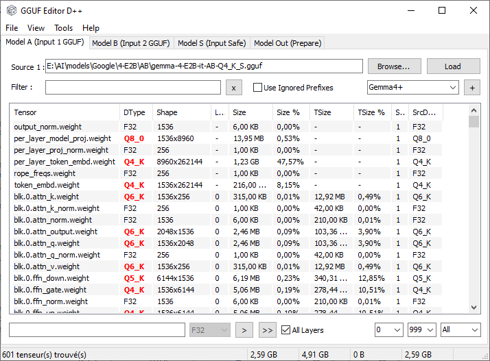

# GGUF Editor D++ 🛠️

### A Windows viewer for GGUF and Safetensors models.

**Open a quantized model and see what is actually inside — no Python, no command line, no notebook.**

Inspect metadata and tensors, plot the real values, compare two files side by side,
preview a quantization before writing anything.

⬇️ [Download](#-download) · 📖 [Documentation](Doc/index.md) · ✨ [Features](#-features) · 🆘 [FAQ](#faq)

---

## TL;DR

You have a `.gguf` file and questions like:

* *“Is this really a llama-3 architecture, and what context length is declared?”*
* *“Which is closer to the FP16 source — my `Q4_K_M` or my `IQ4_XS`?”*
* *“Did my merge actually change `blk.17`, or nothing at all?”*
* *“Where are the outliers in `token_embd.weight`?”*
* *“What does `tokenizer.ggml.precompiled_charsmap` even contain?”*

**GGUF Editor D++ answers those in a few clicks, on Windows, with a single `.exe`.**
No environment to install, no script to adapt, no library version to chase.

### What it is

* A **viewer / inspector** for GGUF and Safetensors: metadata, tensor list, real decoded values.
* A **comparator**: two (or more) models, curves and numbers on the difference.
* A **quantization previewer**: see the result of `Q2_K` on a tensor without producing a file.
* An **editor**, when you decide so: it writes GGUF files that llama.cpp loads without complaint.

### What it is **not**

* ❌ Not an inference engine — it will not run or chat with your model.
* ❌ Not a training or conversion tool (it does not build a GGUF from scratch out of a checkpoint).
* ❌ Not a Python library, and deliberately so: everything happens in the window.

---

## Quick start

1. Download the ZIP, extract it.
2. Double-click the executable.
3. On the \"Model A\" tab: Browse… then Load…   (or just drop a .gguf onto the tab)

That is enough to browse tensors, open the metadata view and plot values.
Nothing is modified, nothing is written, until you press **Save** on purpose.

---

## Three recipes

### 1 · Compare two quants of the same model — no Python

1. Load `llama-3-8b-Q4_K_M.gguf` in **Model A** and `llama-3-8b-Q5_K_M.gguf` in **Model B**.
2. Open **View Tensors**, set the series limit to **`2:ByName`**.
3. Tick one tensor → its twin in the other file gets ticked automatically.
4. Tick **Diff**. The difference curve appears; the status bar shows
   **WRMSE, RMS, MAE, Mean, Min/Max** (with their index) for the range you are looking at.

Zoom with the wheel: the statistics are recomputed for every range, so you can inspect
one block at a time instead of trusting a single global number.

### 2 · Check what a quantization did, before writing it

1. In **Model Out**, select a tensor and pick a target type (e.g. `Q2_K`).
2. Nothing is written to disk: the tensor is only *marked*.
3. Plot it — the curve is produced by dequantize → requantize → dequantize on the fly.
4. Change type or tuning parameters, the graph follows instantly.

### 3 · Inspect a PyTorch checkpoint against a GGUF

Load the GGUF in **Model A**, the `.safetensors` (single file or `…-00001-of-0000N…` set) in
**Model S**, compare by name, and transpose the 2-D matrices that need it — PyTorch and GGUF
disagree on dimension order.

---

## Features

### 👁 Inspect (the viewer core)

| What | Details |
|---|---|
| **Metadata (KVs)** | Every key, with its exact type (`UINT32`, `FLOAT32`, `BOOL`, `STRING`, `ARRAY`, …), grouped by family (General, LLM, Attention, RoPE, Tokenizer, Adapter, CLIP, Split, SSM, iMatrix, …). Editable, with a dedicated dialog for arrays (vocabularies, merges, scores). |
| **Tensor list** | Name, current type, shape, layer index, size, **share of the whole model**, size of the whole pattern (all layers sharing e.g. `attn_q.weight`), original type, source, per-tensor conversion settings. |
| **Sorting & filtering** | Click any header to sort; type `norm`, `blk.12.`, `v_out`… to filter. Per-model filters. |
| **Automatic differences** | Two loaded models are cross-checked: names missing in one, shapes differing, types differing — highlighted in red. |
| **Very large models** | The file is memory-mapped and only the range you look at is decoded. A **160 GB sharded model** opens and browses normally on 16 GB of RAM — it is never copied into memory. |

### 📊 Charts and histograms

* **Values along a tensor**, in F32, with block-start markers and outlier / NaN / Inf flags.
* **Navigation:** wheel = zoom centred on the cursor, drag = pan, two-handle range bar below
  the chart, plus buttons and `+` `-` `<` `>` (also arrow keys).
* **Histograms**, two modes: *fast* (sampled) and *full* (every element counted), reporting
  mean, std-dev, median, mode and skewness.
* **Freezable value window**: uncheck *X-Auto* on the histogram and the bounds lock — two
  distributions or two index ranges then become genuinely comparable.
* **Manual axes** for values and indices, to plot two tensors at the same scale.

### 🆚 Compare

* **4 sources loaded at once:** Model A, B, C (GGUF) and Model S (Safetensors).
* **`2:ByName` mode**: select one tensor, its homologue in another model is selected for you.
* **Two difference modes:** subtraction `T1 - T2` or ratio `T1 / T2`, with an adjustable
  amplification factor so that 1e-4 differences become visible.
* **Weighted metrics**: WRMSE (weighted, the one that matters for a quant), RMS, MAE, Mean,
  Min/Max and their positions, elapsed time.

### 🧠 Quantization (preview or production)

* **Engines you can switch between**, per tensor and per profile:
  native `ggml-base.dll` (llama.cpp) with or without value weighting, deterministic internal
  reference implementation, and five internal optimised engines.
* **Error weighting:** `Uniform`, `√|x|`, `|x|`, `x²`, or none — this decides *where* the error
  is tolerated.
* **Fine control** where the engine uses it: scale-search grid (`Rmin`, `Rdelta`, `Nstep`),
  super-block scale quantisation (`QpStep`, `QpSteps`, `QcIter`), acceptance criterion
  (`UseMAD`), scale-code refinement radius (`RadiusLs`, `RadiusLm`).
* **Presets per type and per profile**, saved between sessions; one click to restore defaults.
* **The DLL is an accelerator, not a dependency.** If `ggml-base.dll` is missing, the internal
  engine takes over and the log says so.

### 🗺 Name mapping

* Rename tensors with `pattern=new_name` rules in a plain text file, using `{}` for the layer
  index; renamed tensors get a `*` in the list.
* Several rule sets, switchable per loaded model, editable in-app, shareable as a single file.
* Custom **layer prefixes** (recognise an architecture the tool does not know yet) and
  **ignored prefixes** (hide tensors nobody cares about).

### ✏ Edit and save (only when you want to)

* Add / change / remove any metadata key, in its exact type.
* Optional automatic `general.edited_by` signature, templatable.
* Transfer tensors from A / B / C / S into the output model — one tensor, one whole pattern
  across all layers, or restricted with layer ranges and `All / Odd / Even / Mod3…Mod8`.
* Tick / untick anything before saving; **long saves are cancellable** and partial files are cleaned up.

### 📦 Split and merge

* **Split** a GGUF into numbered shards under a size limit, with the `split.*` fields written
  exactly as llama.cpp expects them; metadata can go in a separate master file.
* **Merge** shards back into one file, offsets and alignment rewritten.
* Progress per file and per tensor, with speed and duration.

### 🧰 Comfort

* **Log window** (`Show Logs`): what was read, converted, written, timings and throughput for
  every long operation — and a *Log To File* switch, which is what makes a bug report actionable.
* **Drag & drop** a file onto a tab to load it; **command line**:
  `\"GGUF Editor D++.exe\" mymodel.gguf`.
* **Multilingual** UI (English, Français, العربية, 中文(简体/繁體), Deutsch, Español, Русский,
  日本語, 한국어, …) including the bundled documentation.
* Window positions, filters and recent paths are remembered.

---

## Supported tensor types

| Family | Types |
|---|---|
| Floats | `F32`, `F16`, `BF16`, `F64`, `FP8_E4M3`, `FP8_E5M2` (+ `FN` variants) |
| Standard | `Q4_0`, `Q4_1`, `Q5_0`, `Q5_1`, `Q8_0`, `Q8_1` |
| K-quants | `Q2_K`, `Q3_K`, `Q4_K`, `Q5_K`, `Q6_K`, `Q8_K` |
| IQ-quants | `IQ1_S`, `IQ1_M`, `IQ2_XXS`, `IQ2_XS`, `IQ2_S`, `IQ3_XXS`, `IQ3_S`, `IQ4_NL`, `IQ4_XS` |
| FP4 | `MXFP4`, `NVFP4` |
| Ternary | `TQ1_0`, `TQ2_0` |
| Extra | `Q1_0`, `Q2_0` |
| Integer | `I8`, `I16`, `I32`, `I64` |

Unknown types are still listed and their size is recovered from the tensor offsets, so a
future format does not make a file unreadable.

---

## Technical notes

* **Native Windows x64 application** (Delphi / Object Pascal + VCL). No Electron, no .NET, no
  runtime to install, no GPU required. The x64 address space is what makes memory-mapping
  multi-hundred-gigabyte files practical.
* **No bulk loading.** Metadata and tensor headers are parsed once; weight bytes are fetched in
  aligned super-blocks, only for the range being displayed.
* **Decoded on demand.** Displayed values come from dequantization, optionally followed by a
  requantization round-trip (the preview mode).
* **Native interop** with `ggml-base.dll` resolved at runtime (application folder → common
  sub-folders → `PATH`), with a per-type function table you can override through
  `cfg_ggml_type.ini`.
* **Key modules**

  | Module | Role |
  |---|---|
  | `uGGUFReader` / `uGGUFWriter` / `uGGUFParts` | binary I/O, shard reassembly, split & merge |
  | `uMMAPReader` | in-place file access used by every weight read |
  | `uGgmlQuants` + `uGgmlQuants*.pas` | one unit per format family, DLL or internal |
  | `uGGMLQuantUtils` | scale search, weighted least squares, code refinement |
  | `uSafeTensors` / `uTensorTranspose` | Safetensors headers, sharding, transposition |
  | `uTensorsNamesMan` | renaming engine, layer prefixes, per-pattern sizes |
  | `uViewTensors*` | selection, plotting, histograms, diff statistics |
  | `uLangManager` | UI translation |

Full details — GGUF layout, block sizes, `split.*` field types, mapping syntax, files written
next to the executable — are in the bundled documentation:
[`Doc/technical.md`](Doc/technical.md).

---

## Compatibility

* Reads GGUF v2 and v3, sharded or not; reads single and sharded Safetensors.
* Writes GGUF intended to be loaded by **llama.cpp** and by anything built on it
  (LM Studio, KoboldCpp, …): alignment honoured, offsets recomputed,
  `split.count` / `split.no` as `UINT16` and `split.tensors.count` as `INT32`, matching the
  loader's expectations exactly.

---

## 📥 Download

1. Grab the latest `.zip` from [Releases](../../releases).
2. Extract the whole archive (do not move the executable away from its folders and DLLs).
3. Run the executable. **Windows x64 only.**

`ggml-base.dll` is **optional**: without it, the internal engine is used.

---

## FAQ

**Do I need Python, or to install anything?**
No. One executable, double-click. Nothing to pip-install, no CUDA, no GPU required.

**My model is 100 GB+. Will it work?**
Yes, and that is the point of the viewer. Files are memory-mapped and only the range you
display is decoded, so nothing is loaded wholesale into RAM. Verified on a **160 GB sharded
model** on a machine with 16 GB of RAM. It inspects models — it does not run them.

**Can it convert Safetensors to GGUF?**
It can read both and move tensors between them, but it is not a conversion pipeline: it does
not know every architecture's tensor naming out of the box. Use it to *verify* a conversion, or
supply a mapping file for the naming it does not know.

**What is WRMSE and why should I care more about it than RMS?**
WRMSE weights each element by its magnitude, so a handful of huge weights cannot dominate the
score. Raw RMS usually tracks those few weights; WRMSE tracks what the model actually feels.

**The chart looks empty / wrong for a tensor.**
Check the X range and whether *X-Auto* is off with stale bounds, and that the right model
(A/B/C/S/Out) is ticked. The log window reports the exact byte offsets used.

**Something is wrong — how do I report it?**
Open **Show Logs**, tick *Log To File*, reproduce, and attach
`Logs\\Logs_YYYY-MM-DD.txt`. Include the app version (menu *About*), the model, the tensor and
the settings used. The model itself is rarely needed.

---

## Contributing

Contributions are welcome, and the most useful ones are not code:

* **Mapping files** for architectures not recognised yet — a plain `.txt` everyone benefits from.
* **Bug reports** with a log attached.
* Feature requests: a missing column, a metric, an exotic weight format.

---

## Support

If this tool saves you the time of writing yet another script to peek inside a GGUF, you can
support its development:

**PayPal** [abbndz@gmail.com](mailto:abbndz@gmail.com) · **Ko-fi** [ko-fi.com/abbndz](https://ko-fi.com/abbndz) ☕

---

## License

Released under the **MIT License** — see [LICENSE](LICENSE).
You may use, modify and redistribute it, including commercially.

© 2026 GGUF Editor D++ By ABBN.

---

Made with Delphi. If a GGUF file ever confused you, this tool exists for you.
